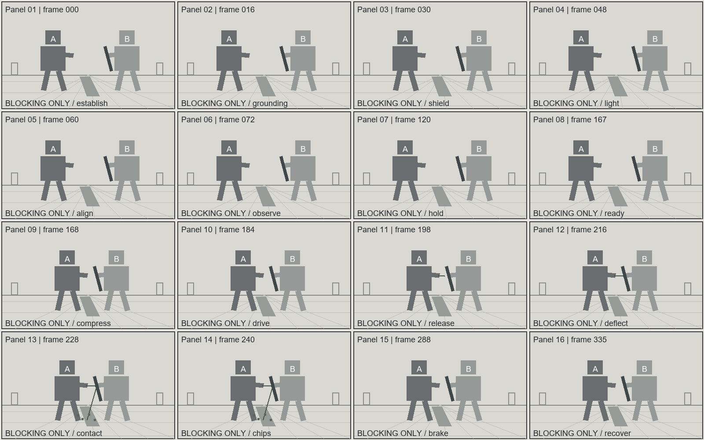

# 重工业机甲｜盾缘导流

状态：完整生产卡及提示词已编译；图像仅有随包灰模构图示意，未调用影视生成模型。

- 总时长：14 秒；最大生成窗：14 秒；24 fps。
- 数据真值源：[01-mecha.production.json](01-mecha.production.json)。
- 声音：现场音；非叙事配乐 N/A。

## 剧情与人物选择

Forge试图穿过维修沟，Ward用盾面导走能量。护盾守住通路，Forge损失一发能量，浅层地面损伤成为下一轮站位限制。

A：一次射流攻击是否突破防线。
B：防守者用退让角度取代硬顶。
C：盾缘导流机制在结果中被证明。

## 登记场景与人物

```json
{
  "scenes": [
    {
      "id": "S01",
      "name": "维修机库",
      "space": "Service trench, two human-sized doors and east-wall maintenance lamp",
      "version": "v1",
      "entrances": [
        "west service route"
      ],
      "exits": [
        "east service route"
      ],
      "landmarks": [
        "Service trench, two human-sized doors and east-wall maintenance lamp"
      ],
      "key_light": "fixed world-east source",
      "prompt_description": "The repair hangar contains a central trench, two human-sized doors and an east-wall maintenance lamp."
    }
  ],
  "characters": [
    {
      "id": "CHAR_FORGE",
      "name": "Forge",
      "height_m": 8.0,
      "identity": "Original design; appearance defined by the production prose, not by a franchise reference",
      "prompt_description": "Forge is an eight-meter bipedal machine with broad ochre shoulders, a square visor and a right-forearm emitter."
    },
    {
      "id": "CHAR_WARD",
      "name": "Ward",
      "height_m": 8.0,
      "identity": "Original design; appearance defined by the production prose, not by a franchise reference",
      "prompt_description": "Ward is an eight-meter machine with overlapping dark armor, a silver visor and a left-arm steel shield."
    }
  ]
}
```

## 逐镜生产卡

### FILM-S01-SH001｜0.000–7.000 秒

Forge stands left of the service trench with its weight carried on the left sole and its right heel lifted nine centimeters off the concrete, both arms hanging low so the right-forearm emitter points at the floor slab a meter ahead of its toes. Ward stands right of the trench with the left shield presented at chest height, the right arm folded behind the shield's trailing edge, and both feet planted a shoulder's width apart on the intact half of the slab. The inside edge of Forge's left foot sits thirty centimeters from the trench lip; the outside edge of Ward's left foot sits one meter from the same lip, so the trench reads as a continuous diagonal line between them and neither machine can reach the other without crossing that line. Forge's square visor is level and faces screen right; Ward's silver visor is level and faces screen left; the two visors hold the same height in frame, which keeps the eight-meter scale of both bodies readable at a glance. Forge's ochre shoulder plates show worn paint at the outer corners and a line of dark grease along the seam above the right elbow; Ward's overlapping dark plates sit tighter, with a narrow band of polished steel visible where the shield's bevel meets the forearm bracket. Neither machine is damaged at the start of this shot, and the concrete slab between them is unbroken. The hangar is a low industrial bay with a central service trench, two human-sized doors set into the rear wall, and a maintenance lamp mounted on the east wall above Ward's shoulder. The east lamp is the only working source: it throws a hard-edged pool of light across the near third of the floor, leaves the doors in half shadow, and catches the top edge of both machines so the upper silhouettes separate from the darker rear wall. Oil haze sits close to the floor and thins above knee height, so the lower half of the frame carries a soft grey veil while the visors stay clear. Loose grit and a few curled paint flakes lie along the trench lip; a shallow scrape mark runs from the lip toward the west door, left over from earlier maintenance work. The rear wall is flat and uncluttered, which gives the two bodies a stable backdrop and keeps the eye on the gap between them. From the south platform, the camera holds a 35 mm lens at chest height and pushes forward half a meter over the shot, starting wide enough to keep both machines, the full trench and both doors inside the frame, and ending with the two visors still inside the top third. The push is straight and slow, decelerating over the last twenty centimeters so the framing settles rather than stops. The horizon stays level; the trench line runs from lower left to lower right across the bottom of frame, and the contact plane between the machines stays near the center at all times. Nothing crosses the lens, and the camera never tilts up, so the eight-meter height reads against the human-sized doors behind. The action inside the shot is small and deliberate. Forge compresses the left leg suspension by roughly ten centimeters, which drops its hip frame and brings the emitter nozzle forward through the oil haze; the right heel settles back onto the concrete with a distinct twin click as both rear pistons take load. Ward answers by rotating the shield two degrees counter-clockwise, which exposes the beveled outer edge and points the shield's face at the emitter rather than at the trench. Ward's right hand closes on the shield's rear grip and its shoulder damper compresses once, visibly, before it holds. Forge's emitter housing rotates a quarter turn and stops; the nozzle irises open and a thin heat shimmer begins to bend the light directly above it, no wider than the housing itself. No energy leaves the emitter in this shot. Material response is limited to what the machines themselves do. Each suspension compression pushes a small pulse of air out from under the soles, lifting a fine ring of dust that travels no more than half a meter before it settles. Grit under Ward's left foot shifts once and stops. The oil haze deforms around Forge's forward shoulder and closes behind it. The east lamp throws a moving highlight along the top of Forge's shoulder plate as the machine settles, and the same highlight stays fixed on Ward's visor because Ward does not move its head. Sound stays tied to visible movement: hydraulic pumps cycle under a steady 35 Hz motor rumble, the two rear pistons click a fraction apart as they take load, Ward's shoulder damper releases one short pneumatic breath, and the emitter's iris makes a single dry mechanical scrape as it opens. The bay holds a low room tone; nothing in the shot suggests wind, weather or an outside space. At the end of the shot the held state is exact: Forge's left sole is planted at the trench lip with the right heel down, the emitter is open and aimed at Ward's shield bevel, and Forge still carries four registered charges. Ward's shield is presented at chest height with its bevel turned toward the emitter, Ward's right hand is on the rear grip, and the supporting concrete slab under both machines remains intact. The gap between the emitter nozzle and the shield bevel measures roughly three meters and is unobstructed, so the next shot can begin from this exact geometry without restating it. The trench keeps a constant width in frame through the whole push, and the amount of floor visible beyond the lip grows steadily as the camera closes, which gives the audience a fixed reference for judging how far apart the two machines stand without any figure or overlay on screen. Forge's shadow stays attached to its left sole and points west, away from the east lamp; Ward's shadow falls behind its shield and never touches the trench. Both shadows hold the same direction for the entire shot, so the light source never appears to move.

```json
{
  "id": "FILM-S01-SH001",
  "scene_id": "S01",
  "start_frame": 0,
  "end_frame": 168,
  "visual": "Forge stands left of the service trench with its weight carried on the left sole and its right heel lifted nine centimeters off the concrete, both arms hanging low so the right-forearm emitter points at the floor slab a meter ahead of its toes. Ward stands right of the trench with the left shield presented at chest height, the right arm folded behind the shield's trailing edge, and both feet planted a shoulder's width apart on the intact half of the slab. The inside edge of Forge's left foot sits thirty centimeters from the trench lip; the outside edge of Ward's left foot sits one meter from the same lip, so the trench reads as a continuous diagonal line between them and neither machine can reach the other without crossing that line. Forge's square visor is level and faces screen right; Ward's silver visor is level and faces screen left; the two visors hold the same height in frame, which keeps the eight-meter scale of both bodies readable at a glance. Forge's ochre shoulder plates show worn paint at the outer corners and a line of dark grease along the seam above the right elbow; Ward's overlapping dark plates sit tighter, with a narrow band of polished steel visible where the shield's bevel meets the forearm bracket. Neither machine is damaged at the start of this shot, and the concrete slab between them is unbroken. The hangar is a low industrial bay with a central service trench, two human-sized doors set into the rear wall, and a maintenance lamp mounted on the east wall above Ward's shoulder. The east lamp is the only working source: it throws a hard-edged pool of light across the near third of the floor, leaves the doors in half shadow, and catches the top edge of both machines so the upper silhouettes separate from the darker rear wall. Oil haze sits close to the floor and thins above knee height, so the lower half of the frame carries a soft grey veil while the visors stay clear. Loose grit and a few curled paint flakes lie along the trench lip; a shallow scrape mark runs from the lip toward the west door, left over from earlier maintenance work. The rear wall is flat and uncluttered, which gives the two bodies a stable backdrop and keeps the eye on the gap between them. From the south platform, the camera holds a 35 mm lens at chest height and pushes forward half a meter over the shot, starting wide enough to keep both machines, the full trench and both doors inside the frame, and ending with the two visors still inside the top third. The push is straight and slow, decelerating over the last twenty centimeters so the framing settles rather than stops. The horizon stays level; the trench line runs from lower left to lower right across the bottom of frame, and the contact plane between the machines stays near the center at all times. Nothing crosses the lens, and the camera never tilts up, so the eight-meter height reads against the human-sized doors behind. The action inside the shot is small and deliberate. Forge compresses the left leg suspension by roughly ten centimeters, which drops its hip frame and brings the emitter nozzle forward through the oil haze; the right heel settles back onto the concrete with a distinct twin click as both rear pistons take load. Ward answers by rotating the shield two degrees counter-clockwise, which exposes the beveled outer edge and points the shield's face at the emitter rather than at the trench. Ward's right hand closes on the shield's rear grip and its shoulder damper compresses once, visibly, before it holds. Forge's emitter housing rotates a quarter turn and stops; the nozzle irises open and a thin heat shimmer begins to bend the light directly above it, no wider than the housing itself. No energy leaves the emitter in this shot. Material response is limited to what the machines themselves do. Each suspension compression pushes a small pulse of air out from under the soles, lifting a fine ring of dust that travels no more than half a meter before it settles. Grit under Ward's left foot shifts once and stops. The oil haze deforms around Forge's forward shoulder and closes behind it. The east lamp throws a moving highlight along the top of Forge's shoulder plate as the machine settles, and the same highlight stays fixed on Ward's visor because Ward does not move its head. Sound stays tied to visible movement: hydraulic pumps cycle under a steady 35 Hz motor rumble, the two rear pistons click a fraction apart as they take load, Ward's shoulder damper releases one short pneumatic breath, and the emitter's iris makes a single dry mechanical scrape as it opens. The bay holds a low room tone; nothing in the shot suggests wind, weather or an outside space. At the end of the shot the held state is exact: Forge's left sole is planted at the trench lip with the right heel down, the emitter is open and aimed at Ward's shield bevel, and Forge still carries four registered charges. Ward's shield is presented at chest height with its bevel turned toward the emitter, Ward's right hand is on the rear grip, and the supporting concrete slab under both machines remains intact. The gap between the emitter nozzle and the shield bevel measures roughly three meters and is unobstructed, so the next shot can begin from this exact geometry without restating it. The trench keeps a constant width in frame through the whole push, and the amount of floor visible beyond the lip grows steadily as the camera closes, which gives the audience a fixed reference for judging how far apart the two machines stand without any figure or overlay on screen. Forge's shadow stays attached to its left sole and points west, away from the east lamp; Ward's shadow falls behind its shield and never touches the trench. Both shadows hold the same direction for the entire shot, so the light source never appears to move.",
  "camera": {
    "previs_id": "052",
    "lens_mm": 35,
    "sensor_basis": "full-frame equivalent",
    "shutter_angle": 180,
    "movement": "slow controlled push",
    "path": "straight 0.5m push from the south-side platform",
    "target": "the visible action and contact plane",
    "adaptation": "project-specific amplitude and speed; source ID is a motion-family reference",
    "description": "From the south platform, the camera slowly pushes forward half a meter, keeping both machines and the trench visible."
  },
  "characters": [
    {
      "id": "CHAR_FORGE",
      "position": [
        0.3,
        0.55
      ],
      "facing": "toward screen right",
      "gaze": "toward Ward",
      "weapon_hand": "right-forearm emitter",
      "weapon_direction": "toward the established contact line"
    },
    {
      "id": "CHAR_WARD",
      "position": [
        0.72,
        0.55
      ],
      "facing": "toward screen left",
      "gaze": "toward Forge",
      "weapon_hand": "left-arm steel shield",
      "weapon_direction": "toward the established contact line"
    }
  ],
  "features": {
    "core_emotion": false,
    "combat": false,
    "supernatural_vfx": false,
    "colossal": false
  },
  "dialogues": [],
  "audio": {
    "foley": [
      "Hydraulic pumps cycle under a steady 35 Hz motor rumble; loose floor grit clicks under the planted soles."
    ],
    "low_frequency_hz": 35,
    "classification": "audible_sub_bass",
    "source": "the established mechanical drive"
  },
  "outcome_events": [],
  "state_in": {
    "characters": {
      "CHAR_FORGE": {
        "ammo": 4,
        "trauma_phase": null
      },
      "CHAR_WARD": {
        "ammo": 0,
        "trauma_phase": null
      }
    },
    "scenes": {
      "S01": 0
    },
    "props": {
      "SHIELD": "CHAR_WARD"
    }
  },
  "state_out": {
    "characters": {
      "CHAR_FORGE": {
        "ammo": 4,
        "trauma_phase": null
      },
      "CHAR_WARD": {
        "ammo": 0,
        "trauma_phase": null
      }
    },
    "scenes": {
      "S01": 0
    },
    "props": {
      "SHIELD": "CHAR_WARD"
    }
  },
  "state_description": "Ward's shield and the supporting concrete slab are intact."
}
```

### FILM-S01-SH002｜7.000–14.000 秒

From the same safe side of the action axis, Forge drives its right forearm emitter along a short forward arc toward the upper outside edge of Ward's raised left shield, while Ward turns its hip frame and angles the shield to meet the incoming line. The service doors, the east-wall lamp and the trench keep the positions they held at the end of the previous shot, so the geometry of the exchange is already established: Forge on screen left, Ward on screen right, the trench running between them, and the contact point sitting slightly above Ward's chest height. Forge's left sole stays planted; its right foot slides forward one boot length and stops, which narrows the gap from three meters to roughly two point two meters by the middle of the shot. Ward's rear sole stays fixed while its front foot pivots thirty degrees outward, opening the hip so the shield can take the impact across its face instead of its edge. The camera tracks laterally one meter with the shield edge on a 50 mm lens, moving east with the deflection and decelerating to a full stop as both machines recover, so the contact line stays unobstructed and near the center of frame for the whole beat. Framing tightens from a full two-body view to a medium shot that keeps Forge's shoulder, the emitter, the shield face and Ward's visor inside the frame, then holds there without a cut. Focus stays on the contact plane and only transfers to Forge's folding elbow after the stream has shut off. Forge releases one charge. A narrow plasma stream leaves the forearm nozzle and stays continuously attached to it, folding along the shield bevel before it reaches the floor rather than bursting outward. The stream is thin, bright at the core and amber at the edges, and it holds a fixed width for the length of the burn instead of flaring. Ward absorbs the hit through the shield face: overlapping plates resist the impact, guide the stream downward, and pass the load into the shoulder damper, which compresses visibly and pushes Ward's rear sole back along the floor by about four centimeters. The shield retracts into the damper and then returns to its presented angle, so the deflection reads as technique rather than as a lucky block. Forge's elbow folds back as the planted left foot absorbs the emitter's recoil, and its shoulder plate rocks back a few degrees before it settles. The deflected stream grazes the concrete top layer beside the trench and shuts off. Only the surface chips detach: small concrete flakes travel outward from the grazing line, arc down and fall into the trench, where they land without a bounce. A thin dust sheet expands close to the floor and thins behind the machines; brief orange sparks peel off the shield's contact edge and fade before they reach the doors. The bright contact core occupies a narrow strip on the shield face, and the soft amber spill stays local, so the east-wall lamp continues to define the armor planes instead of being washed out. The shallow scar left in the concrete runs a short diagonal, well outside the trench lip, and the supporting slab under both machines is still intact. Sound follows the same order as the visible events: the emitter's discharge is a short rising hiss that cuts off with the stream, the shield rings once with a metal resonance that decays over roughly a second, concrete chips tick as they land inside the trench, and Ward's shoulder damper releases a single pneumatic sigh as it returns. Forge's hydraulics run louder during the recoil and settle back to the 35 Hz motor rumble that has been under the scene since the start. At the end of the shot the state is held and exact: Forge carries three registered charges, its elbow is still slightly folded, its left sole is planted at the trench lip and its emitter housing is closed but warm. Ward keeps the shield forward at chest height with the bevel turned toward Forge, its rear sole has slid four centimeters east, and a shallow surface scar now marks the concrete beyond the trench. Dust is still falling, the stream is gone, and both machines hold their new positions, so a following shot can continue from this geometry without restating it. The near lip of the trench stays visible at the bottom of frame for the whole track, so the audience can measure how far Ward's rear sole slides by comparing it against that lip rather than against the moving camera. Forge's shadow swings a few degrees as its shoulder plate rocks back, while Ward's shadow stays fixed behind the shield, which keeps the two bodies readable as separate masses even while the contact core is at its brightest. Ward's visor does not dip when the stream lands; the shield absorbs the hit and the body behind it only settles, which is what makes the deflection read as technique instead of a lucky block. The separated aggregate keeps falling after the stream shuts off, and the intervals between the last few impacts lengthen, so the shot ends on a decaying rhythm instead of an abrupt silence. Forge's emitter housing returns to its rest notch with one small mechanical click that lines up with the last visible settle of the rear ankle, and the oil haze closes back around the machine's shoulder once the heat shimmer stops. Grit thrown up by the rear sole settles back where it started, and the trench stays empty to the very end.

```json
{
  "id": "FILM-S01-SH002",
  "scene_id": "S01",
  "start_frame": 168,
  "end_frame": 336,
  "visual": "From the same safe side of the action axis, Forge drives its right forearm emitter along a short forward arc toward the upper outside edge of Ward's raised left shield, while Ward turns its hip frame and angles the shield to meet the incoming line. The service doors, the east-wall lamp and the trench keep the positions they held at the end of the previous shot, so the geometry of the exchange is already established: Forge on screen left, Ward on screen right, the trench running between them, and the contact point sitting slightly above Ward's chest height. Forge's left sole stays planted; its right foot slides forward one boot length and stops, which narrows the gap from three meters to roughly two point two meters by the middle of the shot. Ward's rear sole stays fixed while its front foot pivots thirty degrees outward, opening the hip so the shield can take the impact across its face instead of its edge. The camera tracks laterally one meter with the shield edge on a 50 mm lens, moving east with the deflection and decelerating to a full stop as both machines recover, so the contact line stays unobstructed and near the center of frame for the whole beat. Framing tightens from a full two-body view to a medium shot that keeps Forge's shoulder, the emitter, the shield face and Ward's visor inside the frame, then holds there without a cut. Focus stays on the contact plane and only transfers to Forge's folding elbow after the stream has shut off. Forge releases one charge. A narrow plasma stream leaves the forearm nozzle and stays continuously attached to it, folding along the shield bevel before it reaches the floor rather than bursting outward. The stream is thin, bright at the core and amber at the edges, and it holds a fixed width for the length of the burn instead of flaring. Ward absorbs the hit through the shield face: overlapping plates resist the impact, guide the stream downward, and pass the load into the shoulder damper, which compresses visibly and pushes Ward's rear sole back along the floor by about four centimeters. The shield retracts into the damper and then returns to its presented angle, so the deflection reads as technique rather than as a lucky block. Forge's elbow folds back as the planted left foot absorbs the emitter's recoil, and its shoulder plate rocks back a few degrees before it settles. The deflected stream grazes the concrete top layer beside the trench and shuts off. Only the surface chips detach: small concrete flakes travel outward from the grazing line, arc down and fall into the trench, where they land without a bounce. A thin dust sheet expands close to the floor and thins behind the machines; brief orange sparks peel off the shield's contact edge and fade before they reach the doors. The bright contact core occupies a narrow strip on the shield face, and the soft amber spill stays local, so the east-wall lamp continues to define the armor planes instead of being washed out. The shallow scar left in the concrete runs a short diagonal, well outside the trench lip, and the supporting slab under both machines is still intact. Sound follows the same order as the visible events: the emitter's discharge is a short rising hiss that cuts off with the stream, the shield rings once with a metal resonance that decays over roughly a second, concrete chips tick as they land inside the trench, and Ward's shoulder damper releases a single pneumatic sigh as it returns. Forge's hydraulics run louder during the recoil and settle back to the 35 Hz motor rumble that has been under the scene since the start. At the end of the shot the state is held and exact: Forge carries three registered charges, its elbow is still slightly folded, its left sole is planted at the trench lip and its emitter housing is closed but warm. Ward keeps the shield forward at chest height with the bevel turned toward Forge, its rear sole has slid four centimeters east, and a shallow surface scar now marks the concrete beyond the trench. Dust is still falling, the stream is gone, and both machines hold their new positions, so a following shot can continue from this geometry without restating it. The near lip of the trench stays visible at the bottom of frame for the whole track, so the audience can measure how far Ward's rear sole slides by comparing it against that lip rather than against the moving camera. Forge's shadow swings a few degrees as its shoulder plate rocks back, while Ward's shadow stays fixed behind the shield, which keeps the two bodies readable as separate masses even while the contact core is at its brightest. Ward's visor does not dip when the stream lands; the shield absorbs the hit and the body behind it only settles, which is what makes the deflection read as technique instead of a lucky block. The separated aggregate keeps falling after the stream shuts off, and the intervals between the last few impacts lengthen, so the shot ends on a decaying rhythm instead of an abrupt silence. Forge's emitter housing returns to its rest notch with one small mechanical click that lines up with the last visible settle of the rear ankle, and the oil haze closes back around the machine's shoulder once the heat shimmer stops. Grit thrown up by the rear sole settles back where it started, and the trench stays empty to the very end.",
  "camera": {
    "previs_id": "039",
    "lens_mm": 50,
    "sensor_basis": "full-frame equivalent",
    "shutter_angle": 180,
    "movement": "slow controlled lateral translation",
    "path": "one-meter eastward track, easing to a hold",
    "target": "the visible action and contact plane",
    "adaptation": "project-specific amplitude and speed; source ID is a motion-family reference",
    "description": "The camera tracks laterally one meter with the shield edge, then decelerates as the machines recover; the contact line remains unobstructed."
  },
  "characters": [
    {
      "id": "CHAR_FORGE",
      "position": [
        0.38,
        0.55
      ],
      "facing": "toward screen right",
      "gaze": "toward Ward",
      "weapon_hand": "right-forearm emitter",
      "weapon_direction": "toward the established contact line"
    },
    {
      "id": "CHAR_WARD",
      "position": [
        0.66,
        0.55
      ],
      "facing": "toward screen left",
      "gaze": "toward Forge",
      "weapon_hand": "left-arm steel shield",
      "weapon_direction": "toward the established contact line"
    }
  ],
  "features": {
    "core_emotion": false,
    "combat": true,
    "supernatural_vfx": true,
    "colossal": false
  },
  "dialogues": [],
  "audio": {
    "foley": [
      "A short metal resonance follows the visible movement."
    ],
    "low_frequency_hz": 35,
    "classification": "audible_sub_bass",
    "source": "the established mechanical drive"
  },
  "outcome_events": [
    "EV_FIRE",
    "EV_SCRAPE"
  ],
  "state_in": {
    "characters": {
      "CHAR_FORGE": {
        "ammo": 4,
        "trauma_phase": null
      },
      "CHAR_WARD": {
        "ammo": 0,
        "trauma_phase": null
      }
    },
    "scenes": {
      "S01": 0
    },
    "props": {
      "SHIELD": "CHAR_WARD"
    }
  },
  "state_out": {
    "characters": {
      "CHAR_FORGE": {
        "ammo": 3,
        "trauma_phase": null
      },
      "CHAR_WARD": {
        "ammo": 0,
        "trauma_phase": null
      }
    },
    "scenes": {
      "S01": 1
    },
    "props": {
      "SHIELD": "CHAR_WARD"
    }
  },
  "vfx": {
    "origin": "Forge's registered right forearm emitter",
    "backbone": "A narrow plasma fluid stream remains continuously attached to the forearm nozzle, folding along the shield bevel before reaching the floor.",
    "collision_type": "impact",
    "collision": "The stream grazes the concrete top layer; only its surface chips detach.",
    "particles": {
      "solid": {
        "present": true,
        "description": "Small concrete chips travel outward from the grazing line and fall into the trench."
      },
      "gas": {
        "present": true,
        "description": "A thin dust sheet expands close to the floor and thins behind the machines."
      },
      "emissive": {
        "present": true,
        "description": "Brief orange sparks peel from the shield's contact edge and fade before reaching the doors."
      }
    },
    "lighting": "The bright contact core occupies a narrow strip; soft amber spill stays local while the east-wall lamp continues to define the armor planes.",
    "phases": [
      {
        "name": "anticipation",
        "start": 0,
        "end": 24
      },
      {
        "name": "release",
        "start": 24,
        "end": 60
      },
      {
        "name": "impact",
        "start": 60,
        "end": 62
      },
      {
        "name": "decay",
        "start": 62,
        "end": 168
      }
    ]
  },
  "state_description": "Ward's shield and the supporting concrete slab are intact."
}
```

## GPT Image 2 / 2.5 可直接复制提示词

按主体、媒介、构图、光材、密度、受控细节、当前风险顺序编译。执行尺寸和采样设置留给实际出图入口。

参考图：必须上传下列文件；只继承明确列出的用途。

- Reference image 1：[上传该图](media/mecha-contact.png)；用途：composition；保留：only Panel 01's left-right placement and ground line; the left block marked A denotes Forge, and the right block marked B denotes Ward；不继承：the grid, letters, panel numbers, gray block anatomy and flat diagram shading; produce one full-frame image。

```text
Reference image 1 supplies composition guidance for the confrontation between Forge and Ward. Preserve only Panel 01's left-right placement and ground line; the left block marked A denotes Forge, and the right block marked B denotes Ward. Do not inherit the grid, letters, panel numbers, gray block anatomy and flat diagram shading; produce one full-frame image.

Create one live-action mechanical confrontation frame inside the repair hangar: Forge at left with broad ochre shoulder plates and square visor, Ward at right with overlapping dark plates and silver visor, its left shield facing Forge's right forearm emitter. Preserve both eight-meter body proportions, the service trench between them, the two human-sized doors and the world-east maintenance lamp. Use a 35 mm equivalent view from the south platform with both soles and the shield contact plane visible. Painted steel stays matte across broad panels, worn shield edges show narrow metal highlights, and ceramic joints remain darker with visible thickness. The east lamp passes through localized oil haze onto the upper armor edges, with weak concrete bounce preserving the shadow-side structure. Concentrate detail at the shield bevel and actuator joints; combine distant trusses into broad quiet forms. Avoid disconnected joints, tiled micro-panels and uniform plastic gloss.
```

## MECHA_SEG01｜16格逐项映射



灰模不代表最终外貌、材质或准确摄影轨迹。

| Panel | Shot | 全局帧 | 单相位 |
|---|---|---:|---|
| 01 | FILM-S01-SH001 | 0 | Both units and the trench are established. |
| 02 | FILM-S01-SH001 | 16 | Forge keeps its left sole planted. |
| 03 | FILM-S01-SH001 | 30 | Ward presents the left shield. |
| 04 | FILM-S01-SH001 | 48 | The east lamp separates the armor planes. |
| 05 | FILM-S01-SH001 | 60 | Forge aligns its forearm with the shield edge. |
| 06 | FILM-S01-SH001 | 72 | Ward watches the aligned nozzle. |
| 07 | FILM-S01-SH001 | 120 | Both positions remain on the established sides. |
| 08 | FILM-S01-SH001 | 167 | The nozzle and shield line are ready. |
| 09 | FILM-S01-SH002 | 168 | Forge compresses the left leg suspension. |
| 10 | FILM-S01-SH002 | 184 | The right shoulder starts the forward drive. |
| 11 | FILM-S01-SH002 | 198 | The emitter stream extends from the nozzle. |
| 12 | FILM-S01-SH002 | 216 | Ward rotates the shield bevel downward. |
| 13 | FILM-S01-SH002 | 228 | The stream reaches the readable contact edge. |
| 14 | FILM-S01-SH002 | 240 | Deflected energy chips the floor surface. |
| 15 | FILM-S01-SH002 | 288 | Ward brakes through the rear sole. |
| 16 | FILM-S01-SH002 | 335 | Forge recovers the arm with a spent charge. |

## MECHA_SEG01｜H3 Ref2VA 完整提示词

```text
subject_definitions:
<Picture 1> is the sixteen-panel gray blocking diagram for [Shot 1] and [Shot 2], providing left-right placement and event order; its schematic figures and flat shading are not appearance or material references.

summary:
[reference generation] The target video follows the blocking and order in <Picture 1>, first establishing the confrontation and then showing the attack, defense, material response and continuing recovery.

retention_analysis:
<Picture 1> (planning reference for [Shot 1] and [Shot 2]): weak_reference - preserve the two figures' relative sides and the ordered action beats, while replacing schematic blocks with the described original character designs in a single full-screen view.

detailed_description:
The video uses grounded live-action mechanical rendering with distinct painted steel and matte ceramic surfaces.
This is a self-contained production instruction and must be readable without the production file, an earlier segment, or a hidden character bible. For every shot, explicitly state: the medium and visible subject appearance, screen position and facing; the current environment, landmarks and light direction; the exact starting pose, prop ownership, contact points and state; the factual trigger for each change; the chronological action, reaction and physical consequence; the camera framing, lens, movement type, direction, path, amplitude, speed and target; the source and timing of dialogue, foley, room tone and breath; the exact held state at the end and what can continue into the next shot. Render objective, social strategy and subtext as observable gaze, breath, posture, hand, facial and voice behavior. Keep cause and effect physically, spatially, temporally and socially coherent. Do not replace a visible action with a vague adjective, skip the transition between beats, collapse preparation, accent, follow-through or settle into one verb, or invent dialogue, objects, voices, cuts or state changes that are not written below.
[Shot 1] Write this shot as a complete independent instruction: restate who is visible and where they are, the environment and light, the start state, the trigger, the ordered action and reaction, the camera path and speed, synchronized sound, and the resulting held state. Forge is an eight-meter bipedal machine with broad ochre shoulders, a square visor and a right-forearm emitter. Ward is an eight-meter machine with overlapping dark armor, a silver visor and a left-arm steel shield. The repair hangar contains a central trench, two human-sized doors and an east-wall maintenance lamp. At the start of this shot: Ward's shield and the supporting concrete slab are intact. From 0.000 to 7.000 seconds of this request, <Picture 1> is the sixteen-panel gray blocking diagram for [Shot 1] and [Shot 2], providing left-right placement and event order; its schematic figures and flat shading are not appearance or material references. Preserve only: <Picture 1> (planning reference for [Shot 1] and [Shot 2]): weak_reference - preserve the two figures' relative sides and the ordered action beats, while replacing schematic blocks with the described original character designs in a single full-screen view.. Forge stands left of the service trench with its weight carried on the left sole and its right heel lifted nine centimeters off the concrete, both arms hanging low so the right-forearm emitter points at the floor slab a meter ahead of its toes. Ward stands right of the trench with the left shield presented at chest height, the right arm folded behind the shield's trailing edge, and both feet planted a shoulder's width apart on the intact half of the slab. The inside edge of Forge's left foot sits thirty centimeters from the trench lip; the outside edge of Ward's left foot sits one meter from the same lip, so the trench reads as a continuous diagonal line between them and neither machine can reach the other without crossing that line. Forge's square visor is level and faces screen right; Ward's silver visor is level and faces screen left; the two visors hold the same height in frame, which keeps the eight-meter scale of both bodies readable at a glance. Forge's ochre shoulder plates show worn paint at the outer corners and a line of dark grease along the seam above the right elbow; Ward's overlapping dark plates sit tighter, with a narrow band of polished steel visible where the shield's bevel meets the forearm bracket. Neither machine is damaged at the start of this shot, and the concrete slab between them is unbroken. The hangar is a low industrial bay with a central service trench, two human-sized doors set into the rear wall, and a maintenance lamp mounted on the east wall above Ward's shoulder. The east lamp is the only working source: it throws a hard-edged pool of light across the near third of the floor, leaves the doors in half shadow, and catches the top edge of both machines so the upper silhouettes separate from the darker rear wall. Oil haze sits close to the floor and thins above knee height, so the lower half of the frame carries a soft grey veil while the visors stay clear. Loose grit and a few curled paint flakes lie along the trench lip; a shallow scrape mark runs from the lip toward the west door, left over from earlier maintenance work. The rear wall is flat and uncluttered, which gives the two bodies a stable backdrop and keeps the eye on the gap between them. From the south platform, the camera holds a 35 mm lens at chest height and pushes forward half a meter over the shot, starting wide enough to keep both machines, the full trench and both doors inside the frame, and ending with the two visors still inside the top third. The push is straight and slow, decelerating over the last twenty centimeters so the framing settles rather than stops. The horizon stays level; the trench line runs from lower left to lower right across the bottom of frame, and the contact plane between the machines stays near the center at all times. Nothing crosses the lens, and the camera never tilts up, so the eight-meter height reads against the human-sized doors behind. The action inside the shot is small and deliberate. Forge compresses the left leg suspension by roughly ten centimeters, which drops its hip frame and brings the emitter nozzle forward through the oil haze; the right heel settles back onto the concrete with a distinct twin click as both rear pistons take load. Ward answers by rotating the shield two degrees counter-clockwise, which exposes the beveled outer edge and points the shield's face at the emitter rather than at the trench. Ward's right hand closes on the shield's rear grip and its shoulder damper compresses once, visibly, before it holds. Forge's emitter housing rotates a quarter turn and stops; the nozzle irises open and a thin heat shimmer begins to bend the light directly above it, no wider than the housing itself. No energy leaves the emitter in this shot. Material response is limited to what the machines themselves do. Each suspension compression pushes a small pulse of air out from under the soles, lifting a fine ring of dust that travels no more than half a meter before it settles. Grit under Ward's left foot shifts once and stops. The oil haze deforms around Forge's forward shoulder and closes behind it. The east lamp throws a moving highlight along the top of Forge's shoulder plate as the machine settles, and the same highlight stays fixed on Ward's visor because Ward does not move its head. Sound stays tied to visible movement: hydraulic pumps cycle under a steady 35 Hz motor rumble, the two rear pistons click a fraction apart as they take load, Ward's shoulder damper releases one short pneumatic breath, and the emitter's iris makes a single dry mechanical scrape as it opens. The bay holds a low room tone; nothing in the shot suggests wind, weather or an outside space. At the end of the shot the held state is exact: Forge's left sole is planted at the trench lip with the right heel down, the emitter is open and aimed at Ward's shield bevel, and Forge still carries four registered charges. Ward's shield is presented at chest height with its bevel turned toward the emitter, Ward's right hand is on the rear grip, and the supporting concrete slab under both machines remains intact. The gap between the emitter nozzle and the shield bevel measures roughly three meters and is unobstructed, so the next shot can begin from this exact geometry without restating it. The trench keeps a constant width in frame through the whole push, and the amount of floor visible beyond the lip grows steadily as the camera closes, which gives the audience a fixed reference for judging how far apart the two machines stand without any figure or overlay on screen. Forge's shadow stays attached to its left sole and points west, away from the east lamp; Ward's shadow falls behind its shield and never touches the trench. Both shadows hold the same direction for the entire shot, so the light source never appears to move. From the south platform, the camera slowly pushes forward half a meter, keeping both machines and the trench visible. The camera uses a 35 mm lens under the full-frame equivalent convention, with a 180-degree shutter-angle convention; movement: slow controlled push; path: straight 0.5m push from the south-side platform; target: the visible action and contact plane. At shot entry, Forge has normalized screen anchor x=0.3, y=0.55 (left-to-right and top-to-bottom); facing toward screen right; gaze toward Ward; hand or weapon state: right-forearm emitter; weapon direction or absence: toward the established contact line. At shot entry, Ward has normalized screen anchor x=0.72, y=0.55 (left-to-right and top-to-bottom); facing toward screen left; gaze toward Forge; hand or weapon state: left-arm steel shield; weapon direction or absence: toward the established contact line. Hydraulic pumps cycle under a steady 35 Hz motor rumble; loose floor grit clicks under the planted soles. The designed low-frequency cue is 35 Hz, sourced from the established mechanical drive. The shot develops the blocking in <Picture 1> Panels 01–08. At the end of this shot, carry forward these recorded constraints: Forge retains 4 recorded ammunition or energy units; the steel shield remains with Ward.
[Shot 2] At 00:07.000, the camera cuts to the following view. Write this shot as a complete independent instruction: restate who is visible and where they are, the environment and light, the start state, the trigger, the ordered action and reaction, the camera path and speed, synchronized sound, and the resulting held state. Forge is an eight-meter bipedal machine with broad ochre shoulders, a square visor and a right-forearm emitter. Ward is an eight-meter machine with overlapping dark armor, a silver visor and a left-arm steel shield. The repair hangar contains a central trench, two human-sized doors and an east-wall maintenance lamp. At the start of this shot: Ward's shield and the supporting concrete slab are intact. From 7.000 to 14.000 seconds of this request, <Picture 1> is the sixteen-panel gray blocking diagram for [Shot 1] and [Shot 2], providing left-right placement and event order; its schematic figures and flat shading are not appearance or material references. Preserve only: <Picture 1> (planning reference for [Shot 1] and [Shot 2]): weak_reference - preserve the two figures' relative sides and the ordered action beats, while replacing schematic blocks with the described original character designs in a single full-screen view.. From the same safe side of the action axis, Forge drives its right forearm emitter along a short forward arc toward the upper outside edge of Ward's raised left shield, while Ward turns its hip frame and angles the shield to meet the incoming line. The service doors, the east-wall lamp and the trench keep the positions they held at the end of the previous shot, so the geometry of the exchange is already established: Forge on screen left, Ward on screen right, the trench running between them, and the contact point sitting slightly above Ward's chest height. Forge's left sole stays planted; its right foot slides forward one boot length and stops, which narrows the gap from three meters to roughly two point two meters by the middle of the shot. Ward's rear sole stays fixed while its front foot pivots thirty degrees outward, opening the hip so the shield can take the impact across its face instead of its edge. The camera tracks laterally one meter with the shield edge on a 50 mm lens, moving east with the deflection and decelerating to a full stop as both machines recover, so the contact line stays unobstructed and near the center of frame for the whole beat. Framing tightens from a full two-body view to a medium shot that keeps Forge's shoulder, the emitter, the shield face and Ward's visor inside the frame, then holds there without a cut. Focus stays on the contact plane and only transfers to Forge's folding elbow after the stream has shut off. Forge releases one charge. A narrow plasma stream leaves the forearm nozzle and stays continuously attached to it, folding along the shield bevel before it reaches the floor rather than bursting outward. The stream is thin, bright at the core and amber at the edges, and it holds a fixed width for the length of the burn instead of flaring. Ward absorbs the hit through the shield face: overlapping plates resist the impact, guide the stream downward, and pass the load into the shoulder damper, which compresses visibly and pushes Ward's rear sole back along the floor by about four centimeters. The shield retracts into the damper and then returns to its presented angle, so the deflection reads as technique rather than as a lucky block. Forge's elbow folds back as the planted left foot absorbs the emitter's recoil, and its shoulder plate rocks back a few degrees before it settles. The deflected stream grazes the concrete top layer beside the trench and shuts off. Only the surface chips detach: small concrete flakes travel outward from the grazing line, arc down and fall into the trench, where they land without a bounce. A thin dust sheet expands close to the floor and thins behind the machines; brief orange sparks peel off the shield's contact edge and fade before they reach the doors. The bright contact core occupies a narrow strip on the shield face, and the soft amber spill stays local, so the east-wall lamp continues to define the armor planes instead of being washed out. The shallow scar left in the concrete runs a short diagonal, well outside the trench lip, and the supporting slab under both machines is still intact. Sound follows the same order as the visible events: the emitter's discharge is a short rising hiss that cuts off with the stream, the shield rings once with a metal resonance that decays over roughly a second, concrete chips tick as they land inside the trench, and Ward's shoulder damper releases a single pneumatic sigh as it returns. Forge's hydraulics run louder during the recoil and settle back to the 35 Hz motor rumble that has been under the scene since the start. At the end of the shot the state is held and exact: Forge carries three registered charges, its elbow is still slightly folded, its left sole is planted at the trench lip and its emitter housing is closed but warm. Ward keeps the shield forward at chest height with the bevel turned toward Forge, its rear sole has slid four centimeters east, and a shallow surface scar now marks the concrete beyond the trench. Dust is still falling, the stream is gone, and both machines hold their new positions, so a following shot can continue from this geometry without restating it. The near lip of the trench stays visible at the bottom of frame for the whole track, so the audience can measure how far Ward's rear sole slides by comparing it against that lip rather than against the moving camera. Forge's shadow swings a few degrees as its shoulder plate rocks back, while Ward's shadow stays fixed behind the shield, which keeps the two bodies readable as separate masses even while the contact core is at its brightest. Ward's visor does not dip when the stream lands; the shield absorbs the hit and the body behind it only settles, which is what makes the deflection read as technique instead of a lucky block. The separated aggregate keeps falling after the stream shuts off, and the intervals between the last few impacts lengthen, so the shot ends on a decaying rhythm instead of an abrupt silence. Forge's emitter housing returns to its rest notch with one small mechanical click that lines up with the last visible settle of the rear ankle, and the oil haze closes back around the machine's shoulder once the heat shimmer stops. Grit thrown up by the rear sole settles back where it started, and the trench stays empty to the very end. The camera tracks laterally one meter with the shield edge, then decelerates as the machines recover; the contact line remains unobstructed. The camera uses a 50 mm lens under the full-frame equivalent convention, with a 180-degree shutter-angle convention; movement: slow controlled lateral translation; path: one-meter eastward track, easing to a hold; target: the visible action and contact plane. At shot entry, Forge has normalized screen anchor x=0.38, y=0.55 (left-to-right and top-to-bottom); facing toward screen right; gaze toward Ward; hand or weapon state: right-forearm emitter; weapon direction or absence: toward the established contact line. At shot entry, Ward has normalized screen anchor x=0.66, y=0.55 (left-to-right and top-to-bottom); facing toward screen left; gaze toward Forge; hand or weapon state: left-arm steel shield; weapon direction or absence: toward the established contact line. Forge's registered right forearm emitter A narrow plasma fluid stream remains continuously attached to the forearm nozzle, folding along the shield bevel before reaching the floor. Small concrete chips travel outward from the grazing line and fall into the trench. A thin dust sheet expands close to the floor and thins behind the machines. Brief orange sparks peel from the shield's contact edge and fade before reaching the doors. The stream grazes the concrete top layer; only its surface chips detach. The bright contact core occupies a narrow strip; soft amber spill stays local while the east-wall lamp continues to define the armor planes. Within this shot, the effect follows anticipation 0.000–1.000s; release 1.000–2.500s; impact 2.500–2.583s; decay 2.583–7.000s. A short metal resonance follows the visible movement. The designed low-frequency cue is 35 Hz, sourced from the established mechanical drive. The shot develops the blocking in <Picture 1> Panels 09–16. At local shot time 00:01.542, the recorded state change is: One registered emitter charge is released. At local shot time 00:02.500, the recorded state change is: The deflected charge chips only the floor surface. At the end of this shot, carry forward these recorded constraints: Forge retains 3 recorded ammunition or energy units; the repair hangar retains surface damage; the steel shield remains with Ward.

overall_soundscape:
A steady 35 Hz mechanical rumble underlies hydraulic hisses, shield scraping and concrete chips landing inside the trench. The hangar gives each impact a short metallic tail.

non_diegetic_music:
N/A
```

## 场记末尾回写

```json
{
  "initial": {
    "characters": {
      "CHAR_FORGE": {
        "ammo": 4,
        "trauma_phase": null
      },
      "CHAR_WARD": {
        "ammo": 0,
        "trauma_phase": null
      }
    },
    "scenes": {
      "S01": 0
    },
    "props": {
      "SHIELD": "CHAR_WARD"
    }
  },
  "events": [
    {
      "id": "EV_FIRE",
      "frame": 205,
      "shot_id": "FILM-S01-SH002",
      "domain": "ammo",
      "target": "CHAR_FORGE",
      "before": 4,
      "after": 3,
      "delta": -1,
      "reason": "One registered emitter charge is released."
    },
    {
      "id": "EV_SCRAPE",
      "frame": 228,
      "shot_id": "FILM-S01-SH002",
      "domain": "damage",
      "target": "S01",
      "before": 0,
      "after": 1,
      "reason": "The deflected charge chips only the floor surface."
    }
  ],
  "final": {
    "characters": {
      "CHAR_FORGE": {
        "ammo": 3,
        "trauma_phase": null
      },
      "CHAR_WARD": {
        "ammo": 0,
        "trauma_phase": null
      }
    },
    "scenes": {
      "S01": 1
    },
    "props": {
      "SHIELD": "CHAR_WARD"
    }
  }
}
```

## 结果验收

运行 audit_storyboard_quality.py 检查当前数据。实际生成后逐帧看身份、接触、主光、伤势和道具；音轨核对对白与频谱。未生成时视觉及声学实测保持 UNVERIFIED。
