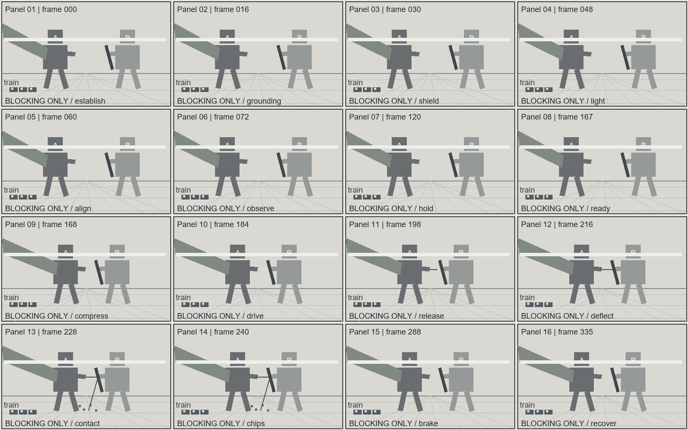

# 超巨构神魔对决｜港湾守线

状态：完整生产卡及提示词已编译；图像仅有随包灰模构图示意，未调用影视生成模型。

- 总时长：14 秒；最大生成窗：14 秒；24 fps。
- 数据真值源：[03-colossal.production.json](03-colossal.production.json)。
- 声音：现场音；非叙事配乐 N/A。

## 剧情与人物选择

港湾中的两座巨体以列车和云带确立尺度。Aer释放一道刃形能量，石哨兵用盾臂把冲击导离列车。盾肋与海墙表层受损，交通承重结构保持，双方带着真实代价进入下一轮。

A：能量是否越过防线。
B：防守者优先保护列车而非自身盾臂。
C：地形承托和导流机制共同限制巨体行动。

## 登记场景与人物

```json
{
  "scenes": [
    {
      "id": "S01",
      "name": "港湾堤道",
      "space": "Harbor shelf, train platform, sea-wall and warehouse skyline",
      "version": "v1",
      "entrances": [
        "west service route"
      ],
      "exits": [
        "east service route"
      ],
      "landmarks": [
        "Harbor shelf, train platform, sea-wall and warehouse skyline"
      ],
      "key_light": "fixed world-east source",
      "prompt_description": "A harbor shelf faces a sea wall, with a train causeway and warehouses behind it."
    }
  ],
  "characters": [
    {
      "id": "CHAR_AER",
      "name": "Aer",
      "height_m": 180,
      "identity": "Original design; appearance defined by the production prose, not by a franchise reference",
      "prompt_description": "Aer is a 180-meter bronze guardian with broad wings and a forearm blade channel."
    },
    {
      "id": "CHAR_GUARDIAN",
      "name": "Stone Sentinel",
      "height_m": 160,
      "identity": "Original design; appearance defined by the production prose, not by a franchise reference",
      "prompt_description": "The Stone Sentinel is a 160-meter dark stone guardian with a ribbed shield forearm."
    }
  ]
}
```

## 逐镜生产卡

### FILM-S01-SH001｜0.000–7.000 秒

Aer stands on the harbor shelf at screen left with both feet planted on the broad stone apron, its torso turned toward the sea wall so the bronze chest plate faces the camera at a shallow angle and the left wing extends past the frame edge. The Stone Sentinel holds the far side of the channel with its base braced against the sea wall, its ribbed shield forearm raised at chest height and its head turned toward Aer, so the two bodies face each other across a kilometer of open water without either leaving its own footing. The maintenance train sits on the causeway between them at the lower left of frame: the leading carriage stands level with Aer's ankle joint, and three carriage doors fit inside the vertical span of one armor plate above that joint, which fixes the scale of both giants against a human-built object before either of them moves. Low east sunlight comes across the water at a shallow angle, catching the leading edge of Aer's wing and the raised face of the sentinel's shield while leaving their far sides in broad shadow; the same light throws both silhouettes onto the warehouse row behind, where Aer's shadow covers four warehouses end to end and the sentinel's covers three. A thin cloud shelf crosses the upper torso of both bodies, lowering their head contrast and leaving the legs sharp against the water, and that shelf drifts slowly east through the shot. The camera starts near the causeway observation platform on a 50 mm lens and pulls back along the platform rail, keeping the train in the lower third, the ankle platform in the middle distance and the harbor horizon level in the upper third. The retreat is steady and slow, roughly one and a half meters of travel, and it never changes height, so the horizon line stays fixed while more of each torso enters frame. Nothing crosses the lens. The framing holds both bodies and the full width of open water between them, and it keeps the train fully inside frame for the entire move so the depth comparison between carriage and ankle never breaks. Aer's first movement is small for a body of that size: it settles its weight by lowering the left shoulder a few degrees, which pulls the near wing down until its tip clears the frame edge and enters the shot, and that single wing movement pushes a broad arc of water outward from the shelf. The wave travels away from Aer in a widening line, breaks against the causeway footing and runs under the train without reaching the carriages. Air displaced by the wing rolls across the shelf and lifts loose grit and salt crust from the stone apron in a low sheet that stays below ankle height. The sentinel answers by rotating its shield forearm half a turn and driving its base plate deeper into the sea wall, which drops its shoulder line by a visible amount and sends a line of small stone fragments down the wall face into the water. Material response stays heavy and slow throughout. The stone apron under Aer's feet compresses slightly, darkening where the surface has taken load before; the water displaced by the wing keeps moving after the wing has stopped, and its rings reach the far wall in the time it takes the sentinel's base plate to finish seating. Dust and salt hang in the air between the two bodies rather than blowing away, because the air is close and the light is low. The train keeps moving along the causeway through the whole shot at walking pace, its wheels clicking over rail joints, and the carriages stay outside the contact zone at all times. Sound is tied to visible motion: the wing's movement produces a single low pressure thump that arrives after the water has already started moving, the wave breaks against the causeway with a flat slap, the sentinel's base plate grinds stone against stone, and the train's wheels click steadily underneath all of it. Wind and harbor water continue as a constant bed, and a designed ground-coupled tone at 35 Hz sits under the stone contact and fades as the wall settles. At the end of the shot the held state is exact: Aer stands on the harbor shelf with its weight settled, the near wing extended over the water, both feet on the stone apron, and two stored pulses still registered in its forearm blade channel. The sentinel holds the sea wall with its shield forearm raised and turned toward Aer, its base plate seated one step deeper than at the start, and its shield rib still unbroken. The train is clear of the contact zone, the causeway bearing structure is undamaged, and the open water between the two bodies is unobstructed, so the next shot can begin from this geometry without restating it. The cloud shelf keeps the same height across both torsos for the entire move, so the two heads stay inside the same band of light and neither body appears larger than the other. Water in the channel holds a single dominant direction of travel, west to east, and the wake from Aer's wing rejoins that direction instead of crossing it. The warehouse row stays in the same plane behind both bodies, which keeps the two shadows on one surface and lets the audience compare their lengths directly. The train slows as it passes the platform, so its wheels click at a wider interval and the carriage doors line up with the ankle joint long enough for the comparison to be read without pausing the shot.

```json
{
  "id": "FILM-S01-SH001",
  "scene_id": "S01",
  "start_frame": 0,
  "end_frame": 168,
  "visual": "Aer stands on the harbor shelf at screen left with both feet planted on the broad stone apron, its torso turned toward the sea wall so the bronze chest plate faces the camera at a shallow angle and the left wing extends past the frame edge. The Stone Sentinel holds the far side of the channel with its base braced against the sea wall, its ribbed shield forearm raised at chest height and its head turned toward Aer, so the two bodies face each other across a kilometer of open water without either leaving its own footing. The maintenance train sits on the causeway between them at the lower left of frame: the leading carriage stands level with Aer's ankle joint, and three carriage doors fit inside the vertical span of one armor plate above that joint, which fixes the scale of both giants against a human-built object before either of them moves. Low east sunlight comes across the water at a shallow angle, catching the leading edge of Aer's wing and the raised face of the sentinel's shield while leaving their far sides in broad shadow; the same light throws both silhouettes onto the warehouse row behind, where Aer's shadow covers four warehouses end to end and the sentinel's covers three. A thin cloud shelf crosses the upper torso of both bodies, lowering their head contrast and leaving the legs sharp against the water, and that shelf drifts slowly east through the shot. The camera starts near the causeway observation platform on a 50 mm lens and pulls back along the platform rail, keeping the train in the lower third, the ankle platform in the middle distance and the harbor horizon level in the upper third. The retreat is steady and slow, roughly one and a half meters of travel, and it never changes height, so the horizon line stays fixed while more of each torso enters frame. Nothing crosses the lens. The framing holds both bodies and the full width of open water between them, and it keeps the train fully inside frame for the entire move so the depth comparison between carriage and ankle never breaks. Aer's first movement is small for a body of that size: it settles its weight by lowering the left shoulder a few degrees, which pulls the near wing down until its tip clears the frame edge and enters the shot, and that single wing movement pushes a broad arc of water outward from the shelf. The wave travels away from Aer in a widening line, breaks against the causeway footing and runs under the train without reaching the carriages. Air displaced by the wing rolls across the shelf and lifts loose grit and salt crust from the stone apron in a low sheet that stays below ankle height. The sentinel answers by rotating its shield forearm half a turn and driving its base plate deeper into the sea wall, which drops its shoulder line by a visible amount and sends a line of small stone fragments down the wall face into the water. Material response stays heavy and slow throughout. The stone apron under Aer's feet compresses slightly, darkening where the surface has taken load before; the water displaced by the wing keeps moving after the wing has stopped, and its rings reach the far wall in the time it takes the sentinel's base plate to finish seating. Dust and salt hang in the air between the two bodies rather than blowing away, because the air is close and the light is low. The train keeps moving along the causeway through the whole shot at walking pace, its wheels clicking over rail joints, and the carriages stay outside the contact zone at all times. Sound is tied to visible motion: the wing's movement produces a single low pressure thump that arrives after the water has already started moving, the wave breaks against the causeway with a flat slap, the sentinel's base plate grinds stone against stone, and the train's wheels click steadily underneath all of it. Wind and harbor water continue as a constant bed, and a designed ground-coupled tone at 35 Hz sits under the stone contact and fades as the wall settles. At the end of the shot the held state is exact: Aer stands on the harbor shelf with its weight settled, the near wing extended over the water, both feet on the stone apron, and two stored pulses still registered in its forearm blade channel. The sentinel holds the sea wall with its shield forearm raised and turned toward Aer, its base plate seated one step deeper than at the start, and its shield rib still unbroken. The train is clear of the contact zone, the causeway bearing structure is undamaged, and the open water between the two bodies is unobstructed, so the next shot can begin from this geometry without restating it. The cloud shelf keeps the same height across both torsos for the entire move, so the two heads stay inside the same band of light and neither body appears larger than the other. Water in the channel holds a single dominant direction of travel, west to east, and the wake from Aer's wing rejoins that direction instead of crossing it. The warehouse row stays in the same plane behind both bodies, which keeps the two shadows on one surface and lets the audience compare their lengths directly. The train slows as it passes the platform, so its wheels click at a wider interval and the carriage doors line up with the ankle joint long enough for the comparison to be read without pausing the shot.",
  "camera": {
    "previs_id": "084",
    "lens_mm": 50,
    "sensor_basis": "full-frame equivalent",
    "shutter_angle": 180,
    "movement": "slow controlled pull",
    "path": "slow backward travel along the causeway observation platform",
    "target": "the visible action and contact plane",
    "adaptation": "project-specific amplitude and speed; source ID is a motion-family reference",
    "description": "The camera slowly pulls back along the causeway, retaining the train, ankle platform and harbor horizon."
  },
  "characters": [
    {
      "id": "CHAR_AER",
      "position": [
        0.32,
        0.55
      ],
      "facing": "toward screen right",
      "gaze": "toward Stone Sentinel",
      "weapon_hand": "forearm blade channel",
      "weapon_direction": "toward the established contact line"
    },
    {
      "id": "CHAR_GUARDIAN",
      "position": [
        0.74,
        0.55
      ],
      "facing": "toward screen left",
      "gaze": "toward Aer",
      "weapon_hand": "ribbed shield forearm",
      "weapon_direction": "toward the established contact line"
    }
  ],
  "features": {
    "core_emotion": false,
    "combat": false,
    "supernatural_vfx": false,
    "colossal": true
  },
  "dialogues": [],
  "audio": {
    "foley": [
      "Train wheels click along the causeway under wind and harbor water."
    ],
    "low_frequency_hz": 35,
    "classification": "audible_sub_bass",
    "source": "designed ground-coupled resonance at the harbor wall"
  },
  "outcome_events": [],
  "state_in": {
    "characters": {
      "CHAR_AER": {
        "ammo": 2,
        "trauma_phase": null
      },
      "CHAR_GUARDIAN": {
        "ammo": 0,
        "trauma_phase": null
      }
    },
    "scenes": {
      "S01": 0
    },
    "props": {
      "STONE_SHIELD": "CHAR_GUARDIAN"
    }
  },
  "state_out": {
    "characters": {
      "CHAR_AER": {
        "ammo": 2,
        "trauma_phase": null
      },
      "CHAR_GUARDIAN": {
        "ammo": 0,
        "trauma_phase": null
      }
    },
    "scenes": {
      "S01": 0
    },
    "props": {
      "STONE_SHIELD": "CHAR_GUARDIAN"
    }
  },
  "scale_proofs": [
    {
      "type": "benchmark",
      "detail": "Ankle and train share depth; one armor joint spans several carriage doors.",
      "frame_location": "lower-left causeway",
      "depth_relation": "train and ankle share the same ground plane"
    },
    {
      "type": "environment",
      "detail": "Wing pressure pushes waves; its shadow spans warehouses.",
      "frame_location": "harbor midground and opposite shore",
      "depth_relation": "wave and shadow connect the guardian to the distant port"
    },
    {
      "type": "atmosphere",
      "detail": "Clouds cross the torso, lowering head contrast while leaving the legs clear.",
      "frame_location": "upper torso",
      "depth_relation": "cloud layer sits between camera and upper body"
    }
  ],
  "state_description": "The train route is clear and the shield rib intact."
}
```

### FILM-S01-SH002｜7.000–14.000 秒

Aer braces on the harbor shelf with its knees flexed and its weight shifted onto the leading foot, torso rotated so the forearm blade channel points across the channel at the sentinel's raised shield. The sentinel keeps its base against the sea wall, the shield forearm turned outward to present the stone rib, and the maintenance train stays on the causeway outside the contact zone with its leading carriage level with Aer's ankle. The water between them keeps the same width it held at the end of the previous shot, and the cloud shelf still crosses the upper torso of both bodies, so the scale comparison built in that shot carries forward unchanged. The camera tracks parallel to the harbor wall on a 70 mm lens, moving east with the deflection at roughly the speed of a walking person, and holds the shield contact, the stone rib and the causeway ground reference in one medium-wide view. The track decelerates as the pulse is turned away and stops when the stone settles, so the frame never loses the sea-wall base or the train. Focus stays on the contact between blade channel and shield rib, then transfers to the wall face where the transformed load arrives. Aer sends one blade-shaped pulse from the forearm channel. The fluid stays attached to the channel along its full length, narrow at the origin and slightly wider at the leading edge, and it travels on a downward arc rather than a straight line, so its path reads as a guided strike instead of a projectile. The leading section meets the shield's outer stone rib and stops there. Layered stone resists compression for a moment before the outer rib flakes away, and the sentinel turns the shield a few degrees to guide the pulse down and away from the train rather than through it. The retreating forearm passes the load into the torso and down into the sea-wall brace, which is why the wall cracks in a short vertical line instead of collapsing: the bearing base stays intact and only the facing gives way. Aer absorbs the reaction by lowering its far wing and bending the planted knee, which brakes its rotation and keeps the near foot flat on the apron. The contact outline holds for a beat while the clouds keep drifting, then the pulse shuts off and the effects settle in their own time. Broad stone flakes separate only from the damaged rib and drop toward the harbor edge, striking the water below the wall and not the causeway. A low dust plume follows the shield surface and thins out across the water instead of rising. Sparse amber light points detach from the fluid edge and go out inside the contact region, so nothing drifts into the sky. The narrow white contact line fades to soft amber edges against the blue-gray shadow of the wall, and the low east sun stays the dominant world source, which keeps the water bright on the far side and the wall face dark. Sound follows the visible order: the pulse's release is a short rising tone, the rib's failure is a delayed stone crack that arrives after the flakes have already begun to fall, the wall facing breaks with a second crack a beat later, and the debris hits the water in a series of flat splashes. The 35 Hz ground-coupled tone swells at the wall contact and decays as the base settles. The train keeps clicking along the causeway throughout, and wind and harbor water continue underneath. At the end of the shot both giants remain supported. Aer holds the shelf with its knees still flexed, its wing low, and one stored pulse left in the blade channel. The sentinel keeps its shield forearm raised with the outer rib broken and hanging open, its base plate still seated in the sea wall, and a short vertical crack now marks the wall facing above the bearing line. The causeway and the train are untouched, stone flakes are still falling toward the water, and the open channel between the two bodies stays clear, so a following shot can continue from this exact geometry. The broken rib stays attached at its lower edge and swings only a few degrees, so the damage reads as structural fatigue rather than as a severed limb. Water below the wall carries the falling flakes away from the causeway footing, and none of them reach the rail bed. The sentinel's head stays turned toward Aer for the whole beat, so the exchange continues as a contest of footing rather than of aim. The wall's facing keeps its new crack for the rest of the shot; the bearing line below it does not move, which is what keeps the causeway usable for the next exchange. Neither body shifts its footing before the shot ends, so the last frame repeats the opening geometry at the track's closer distance.

```json
{
  "id": "FILM-S01-SH002",
  "scene_id": "S01",
  "start_frame": 168,
  "end_frame": 336,
  "visual": "Aer braces on the harbor shelf with its knees flexed and its weight shifted onto the leading foot, torso rotated so the forearm blade channel points across the channel at the sentinel's raised shield. The sentinel keeps its base against the sea wall, the shield forearm turned outward to present the stone rib, and the maintenance train stays on the causeway outside the contact zone with its leading carriage level with Aer's ankle. The water between them keeps the same width it held at the end of the previous shot, and the cloud shelf still crosses the upper torso of both bodies, so the scale comparison built in that shot carries forward unchanged. The camera tracks parallel to the harbor wall on a 70 mm lens, moving east with the deflection at roughly the speed of a walking person, and holds the shield contact, the stone rib and the causeway ground reference in one medium-wide view. The track decelerates as the pulse is turned away and stops when the stone settles, so the frame never loses the sea-wall base or the train. Focus stays on the contact between blade channel and shield rib, then transfers to the wall face where the transformed load arrives. Aer sends one blade-shaped pulse from the forearm channel. The fluid stays attached to the channel along its full length, narrow at the origin and slightly wider at the leading edge, and it travels on a downward arc rather than a straight line, so its path reads as a guided strike instead of a projectile. The leading section meets the shield's outer stone rib and stops there. Layered stone resists compression for a moment before the outer rib flakes away, and the sentinel turns the shield a few degrees to guide the pulse down and away from the train rather than through it. The retreating forearm passes the load into the torso and down into the sea-wall brace, which is why the wall cracks in a short vertical line instead of collapsing: the bearing base stays intact and only the facing gives way. Aer absorbs the reaction by lowering its far wing and bending the planted knee, which brakes its rotation and keeps the near foot flat on the apron. The contact outline holds for a beat while the clouds keep drifting, then the pulse shuts off and the effects settle in their own time. Broad stone flakes separate only from the damaged rib and drop toward the harbor edge, striking the water below the wall and not the causeway. A low dust plume follows the shield surface and thins out across the water instead of rising. Sparse amber light points detach from the fluid edge and go out inside the contact region, so nothing drifts into the sky. The narrow white contact line fades to soft amber edges against the blue-gray shadow of the wall, and the low east sun stays the dominant world source, which keeps the water bright on the far side and the wall face dark. Sound follows the visible order: the pulse's release is a short rising tone, the rib's failure is a delayed stone crack that arrives after the flakes have already begun to fall, the wall facing breaks with a second crack a beat later, and the debris hits the water in a series of flat splashes. The 35 Hz ground-coupled tone swells at the wall contact and decays as the base settles. The train keeps clicking along the causeway throughout, and wind and harbor water continue underneath. At the end of the shot both giants remain supported. Aer holds the shelf with its knees still flexed, its wing low, and one stored pulse left in the blade channel. The sentinel keeps its shield forearm raised with the outer rib broken and hanging open, its base plate still seated in the sea wall, and a short vertical crack now marks the wall facing above the bearing line. The causeway and the train are untouched, stone flakes are still falling toward the water, and the open channel between the two bodies stays clear, so a following shot can continue from this exact geometry. The broken rib stays attached at its lower edge and swings only a few degrees, so the damage reads as structural fatigue rather than as a severed limb. Water below the wall carries the falling flakes away from the causeway footing, and none of them reach the rail bed. The sentinel's head stays turned toward Aer for the whole beat, so the exchange continues as a contest of footing rather than of aim. The wall's facing keeps its new crack for the rest of the shot; the bearing line below it does not move, which is what keeps the causeway usable for the next exchange. Neither body shifts its footing before the shot ends, so the last frame repeats the opening geometry at the track's closer distance.",
  "camera": {
    "previs_id": "039",
    "lens_mm": 70,
    "sensor_basis": "full-frame equivalent",
    "shutter_angle": 180,
    "movement": "slow controlled lateral translation",
    "path": "lateral tracking along the original safe side of the harbor wall",
    "target": "the visible action and contact plane",
    "adaptation": "project-specific amplitude and speed; source ID is a motion-family reference",
    "description": "The camera tracks parallel to the harbor wall, holding the shield contact and the ground reference in the same medium-wide view."
  },
  "characters": [
    {
      "id": "CHAR_AER",
      "position": [
        0.38,
        0.55
      ],
      "facing": "toward screen right",
      "gaze": "toward Stone Sentinel",
      "weapon_hand": "forearm blade channel",
      "weapon_direction": "toward the established contact line"
    },
    {
      "id": "CHAR_GUARDIAN",
      "position": [
        0.68,
        0.55
      ],
      "facing": "toward screen left",
      "gaze": "toward Aer",
      "weapon_hand": "ribbed shield forearm",
      "weapon_direction": "toward the established contact line"
    }
  ],
  "features": {
    "core_emotion": false,
    "combat": true,
    "supernatural_vfx": true,
    "colossal": true
  },
  "dialogues": [],
  "audio": {
    "foley": [
      "A delayed stone resonance follows the visible contact, with wind and harbor water continuing underneath."
    ],
    "low_frequency_hz": 35,
    "classification": "audible_sub_bass",
    "source": "designed ground-coupled resonance at the harbor wall"
  },
  "outcome_events": [
    "EV_PULSE",
    "EV_WALL",
    "EV_SHIELD"
  ],
  "state_in": {
    "characters": {
      "CHAR_AER": {
        "ammo": 2,
        "trauma_phase": null
      },
      "CHAR_GUARDIAN": {
        "ammo": 0,
        "trauma_phase": null
      }
    },
    "scenes": {
      "S01": 0
    },
    "props": {
      "STONE_SHIELD": "CHAR_GUARDIAN"
    }
  },
  "state_out": {
    "characters": {
      "CHAR_AER": {
        "ammo": 1,
        "trauma_phase": null
      },
      "CHAR_GUARDIAN": {
        "ammo": 0,
        "trauma_phase": 0
      }
    },
    "scenes": {
      "S01": 2
    },
    "props": {
      "STONE_SHIELD": "CHAR_GUARDIAN"
    }
  },
  "scale_proofs": [
    {
      "type": "benchmark",
      "detail": "Ankle and train share depth; one armor joint spans several carriage doors.",
      "frame_location": "lower-left causeway",
      "depth_relation": "train and ankle share the same ground plane"
    },
    {
      "type": "environment",
      "detail": "Wing pressure pushes waves; its shadow spans warehouses.",
      "frame_location": "harbor midground and opposite shore",
      "depth_relation": "wave and shadow connect the guardian to the distant port"
    }
  ],
  "vfx": {
    "origin": "Aer's registered forearm blade channel",
    "backbone": "A thin blade-shaped luminous fluid remains attached to Aer's forearm channel before its leading section strikes the shield rib.",
    "collision_type": "impact",
    "collision": "The outer stone rib flakes at the contact line; the sea-wall surface cracks but its load-bearing base remains intact.",
    "particles": {
      "solid": {
        "present": true,
        "description": "Broad stone flakes separate only from the damaged rib and drop toward the harbor edge."
      },
      "gas": {
        "present": true,
        "description": "A low dust plume follows the shield surface and thins across the water."
      },
      "emissive": {
        "present": true,
        "description": "Sparse amber light points detach from the fluid edge and extinguish within the contact region."
      }
    },
    "lighting": "A narrow white contact line fades to soft amber edges against blue-gray shadow; the east sun remains the dominant world source.",
    "phases": [
      {
        "name": "anticipation",
        "start": 0,
        "end": 24
      },
      {
        "name": "release",
        "start": 24,
        "end": 60
      },
      {
        "name": "impact",
        "start": 60,
        "end": 62
      },
      {
        "name": "decay",
        "start": 62,
        "end": 168
      }
    ]
  },
  "state_description": "The train route is clear and the shield rib intact."
}
```

## GPT Image 2 / 2.5 可直接复制提示词

按主体、媒介、构图、光材、密度、受控细节、当前风险顺序编译。执行尺寸和采样设置留给实际出图入口。

参考图：必须上传下列文件；只继承明确列出的用途。

- Reference image 1：[上传该图](media/colossal-contact.png)；用途：composition；保留：only Panel 01's left-right placement and ground line; the left block marked A denotes Aer, and the right block marked B denotes Stone Sentinel；不继承：the grid, letters, panel numbers, gray block anatomy and flat diagram shading; produce one full-frame image。

```text
Reference image 1 supplies composition guidance for the confrontation between Aer and Stone Sentinel. Preserve only Panel 01's left-right placement and ground line; the left block marked A denotes Aer, and the right block marked B denotes Stone Sentinel. Do not inherit the grid, letters, panel numbers, gray block anatomy and flat diagram shading; produce one full-frame image.

Create one cel-shaded harbor confrontation keyframe with a 180-meter winged bronze guardian at left and a 160-meter stone sentinel at right. The maintenance train touches the guardian's ankle platform at the same depth, while a cloud shelf crosses the upper torso and the wing shadow spans multiple warehouse roofs. Keep one clear vertical silhouette and let the left wing leave the frame. Use a distant causeway observer and a 50 mm equivalent lens; retain the harbor horizon and usable railway route. Low east sunlight defines three large value masses. Bronze panels receive narrow directional highlights, the intact stone shield ribs show broad matte planes and clear edge thickness. The train doors remain legible scale modules; distant roof details merge into lower-contrast atmosphere. Capture the grounded opening stance before the attack; the forearm channel is unlit and no energy has been emitted. Avoid miniature tilt-shift blur, repeated ornamental texture and disconnected load-bearing structure.
```

## COLOSSAL_SEG01｜16格逐项映射



灰模不代表最终外貌、材质或准确摄影轨迹。

| Panel | Shot | 全局帧 | 单相位 |
|---|---|---:|---|
| 01 | FILM-S01-SH001 | 0 | Train and guardian ankle share a depth plane. |
| 02 | FILM-S01-SH001 | 16 | The wing extends beyond the left frame edge. |
| 03 | FILM-S01-SH001 | 30 | The cloud shelf crosses the upper torso. |
| 04 | FILM-S01-SH001 | 48 | A broad shadow crosses warehouses. |
| 05 | FILM-S01-SH001 | 60 | The sentinel holds the opposing shore. |
| 06 | FILM-S01-SH001 | 72 | The water between both bodies remains visible. |
| 07 | FILM-S01-SH001 | 120 | Aer lowers its foot onto the shelf. |
| 08 | FILM-S01-SH001 | 167 | The forearm channel aligns with the shield. |
| 09 | FILM-S01-SH002 | 168 | Aer compresses its planted leg. |
| 10 | FILM-S01-SH002 | 184 | The torso transfers load to the shoulder. |
| 11 | FILM-S01-SH002 | 198 | A blade-shaped fluid pulse extends. |
| 12 | FILM-S01-SH002 | 216 | The sentinel rotates its stone forearm. |
| 13 | FILM-S01-SH002 | 228 | The shield rib receives the readable contact. |
| 14 | FILM-S01-SH002 | 240 | Stone flakes leave the shield rib. |
| 15 | FILM-S01-SH002 | 288 | The wall facing cracks above its support. |
| 16 | FILM-S01-SH002 | 335 | Both giants recover while the cloud layer moves. |

## COLOSSAL_SEG01｜H3 Ref2VA 完整提示词

```text
subject_definitions:
<Picture 1> is the sixteen-panel gray blocking diagram for [Shot 1] and [Shot 2], providing left-right placement and event order; its schematic figures and flat shading are not appearance or material references.

summary:
[reference generation] The target video follows the blocking and order in <Picture 1>, first establishing the confrontation and then showing the attack, defense, material response and continuing recovery.

retention_analysis:
<Picture 1> (planning reference for [Shot 1] and [Shot 2]): weak_reference - preserve the two figures' relative sides and the ordered action beats, while replacing schematic blocks with the described original character designs in a single full-screen view.

detailed_description:
The sequence uses large cel-shaded forms, selective painted atmosphere and restrained luminous edges.
This is a self-contained production instruction and must be readable without the production file, an earlier segment, or a hidden character bible. For every shot, explicitly state: the medium and visible subject appearance, screen position and facing; the current environment, landmarks and light direction; the exact starting pose, prop ownership, contact points and state; the factual trigger for each change; the chronological action, reaction and physical consequence; the camera framing, lens, movement type, direction, path, amplitude, speed and target; the source and timing of dialogue, foley, room tone and breath; the exact held state at the end and what can continue into the next shot. Render objective, social strategy and subtext as observable gaze, breath, posture, hand, facial and voice behavior. Keep cause and effect physically, spatially, temporally and socially coherent. Do not replace a visible action with a vague adjective, skip the transition between beats, collapse preparation, accent, follow-through or settle into one verb, or invent dialogue, objects, voices, cuts or state changes that are not written below.
[Shot 1] Write this shot as a complete independent instruction: restate who is visible and where they are, the environment and light, the start state, the trigger, the ordered action and reaction, the camera path and speed, synchronized sound, and the resulting held state. Aer is a 180-meter bronze guardian with broad wings and a forearm blade channel. The Stone Sentinel is a 160-meter dark stone guardian with a ribbed shield forearm. A harbor shelf faces a sea wall, with a train causeway and warehouses behind it. At the start of this shot: The train route is clear and the shield rib intact. From 0.000 to 7.000 seconds of this request, <Picture 1> is the sixteen-panel gray blocking diagram for [Shot 1] and [Shot 2], providing left-right placement and event order; its schematic figures and flat shading are not appearance or material references. Preserve only: <Picture 1> (planning reference for [Shot 1] and [Shot 2]): weak_reference - preserve the two figures' relative sides and the ordered action beats, while replacing schematic blocks with the described original character designs in a single full-screen view.. Aer stands on the harbor shelf at screen left with both feet planted on the broad stone apron, its torso turned toward the sea wall so the bronze chest plate faces the camera at a shallow angle and the left wing extends past the frame edge. The Stone Sentinel holds the far side of the channel with its base braced against the sea wall, its ribbed shield forearm raised at chest height and its head turned toward Aer, so the two bodies face each other across a kilometer of open water without either leaving its own footing. The maintenance train sits on the causeway between them at the lower left of frame: the leading carriage stands level with Aer's ankle joint, and three carriage doors fit inside the vertical span of one armor plate above that joint, which fixes the scale of both giants against a human-built object before either of them moves. Low east sunlight comes across the water at a shallow angle, catching the leading edge of Aer's wing and the raised face of the sentinel's shield while leaving their far sides in broad shadow; the same light throws both silhouettes onto the warehouse row behind, where Aer's shadow covers four warehouses end to end and the sentinel's covers three. A thin cloud shelf crosses the upper torso of both bodies, lowering their head contrast and leaving the legs sharp against the water, and that shelf drifts slowly east through the shot. The camera starts near the causeway observation platform on a 50 mm lens and pulls back along the platform rail, keeping the train in the lower third, the ankle platform in the middle distance and the harbor horizon level in the upper third. The retreat is steady and slow, roughly one and a half meters of travel, and it never changes height, so the horizon line stays fixed while more of each torso enters frame. Nothing crosses the lens. The framing holds both bodies and the full width of open water between them, and it keeps the train fully inside frame for the entire move so the depth comparison between carriage and ankle never breaks. Aer's first movement is small for a body of that size: it settles its weight by lowering the left shoulder a few degrees, which pulls the near wing down until its tip clears the frame edge and enters the shot, and that single wing movement pushes a broad arc of water outward from the shelf. The wave travels away from Aer in a widening line, breaks against the causeway footing and runs under the train without reaching the carriages. Air displaced by the wing rolls across the shelf and lifts loose grit and salt crust from the stone apron in a low sheet that stays below ankle height. The sentinel answers by rotating its shield forearm half a turn and driving its base plate deeper into the sea wall, which drops its shoulder line by a visible amount and sends a line of small stone fragments down the wall face into the water. Material response stays heavy and slow throughout. The stone apron under Aer's feet compresses slightly, darkening where the surface has taken load before; the water displaced by the wing keeps moving after the wing has stopped, and its rings reach the far wall in the time it takes the sentinel's base plate to finish seating. Dust and salt hang in the air between the two bodies rather than blowing away, because the air is close and the light is low. The train keeps moving along the causeway through the whole shot at walking pace, its wheels clicking over rail joints, and the carriages stay outside the contact zone at all times. Sound is tied to visible motion: the wing's movement produces a single low pressure thump that arrives after the water has already started moving, the wave breaks against the causeway with a flat slap, the sentinel's base plate grinds stone against stone, and the train's wheels click steadily underneath all of it. Wind and harbor water continue as a constant bed, and a designed ground-coupled tone at 35 Hz sits under the stone contact and fades as the wall settles. At the end of the shot the held state is exact: Aer stands on the harbor shelf with its weight settled, the near wing extended over the water, both feet on the stone apron, and two stored pulses still registered in its forearm blade channel. The sentinel holds the sea wall with its shield forearm raised and turned toward Aer, its base plate seated one step deeper than at the start, and its shield rib still unbroken. The train is clear of the contact zone, the causeway bearing structure is undamaged, and the open water between the two bodies is unobstructed, so the next shot can begin from this geometry without restating it. The cloud shelf keeps the same height across both torsos for the entire move, so the two heads stay inside the same band of light and neither body appears larger than the other. Water in the channel holds a single dominant direction of travel, west to east, and the wake from Aer's wing rejoins that direction instead of crossing it. The warehouse row stays in the same plane behind both bodies, which keeps the two shadows on one surface and lets the audience compare their lengths directly. The train slows as it passes the platform, so its wheels click at a wider interval and the carriage doors line up with the ankle joint long enough for the comparison to be read without pausing the shot. The camera slowly pulls back along the causeway, retaining the train, ankle platform and harbor horizon. The camera uses a 50 mm lens under the full-frame equivalent convention, with a 180-degree shutter-angle convention; movement: slow controlled pull; path: slow backward travel along the causeway observation platform; target: the visible action and contact plane. At shot entry, Aer has normalized screen anchor x=0.32, y=0.55 (left-to-right and top-to-bottom); facing toward screen right; gaze toward Stone Sentinel; hand or weapon state: forearm blade channel; weapon direction or absence: toward the established contact line. At shot entry, Stone Sentinel has normalized screen anchor x=0.74, y=0.55 (left-to-right and top-to-bottom); facing toward screen left; gaze toward Aer; hand or weapon state: ribbed shield forearm; weapon direction or absence: toward the established contact line. Ankle and train share depth; one armor joint spans several carriage doors. Visible at lower-left causeway; depth relationship: train and ankle share the same ground plane. Wing pressure pushes waves; its shadow spans warehouses. Visible at harbor midground and opposite shore; depth relationship: wave and shadow connect the guardian to the distant port. Clouds cross the torso, lowering head contrast while leaving the legs clear. Visible at upper torso; depth relationship: cloud layer sits between camera and upper body. Train wheels click along the causeway under wind and harbor water. The designed low-frequency cue is 35 Hz, sourced from designed ground-coupled resonance at the harbor wall. The shot develops the blocking in <Picture 1> Panels 01–08. At the end of this shot, carry forward these recorded constraints: Aer retains 2 recorded ammunition or energy units; the stone shield remains with Stone Sentinel.
[Shot 2] At 00:07.000, the camera cuts to the following view. Write this shot as a complete independent instruction: restate who is visible and where they are, the environment and light, the start state, the trigger, the ordered action and reaction, the camera path and speed, synchronized sound, and the resulting held state. Aer is a 180-meter bronze guardian with broad wings and a forearm blade channel. The Stone Sentinel is a 160-meter dark stone guardian with a ribbed shield forearm. A harbor shelf faces a sea wall, with a train causeway and warehouses behind it. At the start of this shot: The train route is clear and the shield rib intact. From 7.000 to 14.000 seconds of this request, <Picture 1> is the sixteen-panel gray blocking diagram for [Shot 1] and [Shot 2], providing left-right placement and event order; its schematic figures and flat shading are not appearance or material references. Preserve only: <Picture 1> (planning reference for [Shot 1] and [Shot 2]): weak_reference - preserve the two figures' relative sides and the ordered action beats, while replacing schematic blocks with the described original character designs in a single full-screen view.. Aer braces on the harbor shelf with its knees flexed and its weight shifted onto the leading foot, torso rotated so the forearm blade channel points across the channel at the sentinel's raised shield. The sentinel keeps its base against the sea wall, the shield forearm turned outward to present the stone rib, and the maintenance train stays on the causeway outside the contact zone with its leading carriage level with Aer's ankle. The water between them keeps the same width it held at the end of the previous shot, and the cloud shelf still crosses the upper torso of both bodies, so the scale comparison built in that shot carries forward unchanged. The camera tracks parallel to the harbor wall on a 70 mm lens, moving east with the deflection at roughly the speed of a walking person, and holds the shield contact, the stone rib and the causeway ground reference in one medium-wide view. The track decelerates as the pulse is turned away and stops when the stone settles, so the frame never loses the sea-wall base or the train. Focus stays on the contact between blade channel and shield rib, then transfers to the wall face where the transformed load arrives. Aer sends one blade-shaped pulse from the forearm channel. The fluid stays attached to the channel along its full length, narrow at the origin and slightly wider at the leading edge, and it travels on a downward arc rather than a straight line, so its path reads as a guided strike instead of a projectile. The leading section meets the shield's outer stone rib and stops there. Layered stone resists compression for a moment before the outer rib flakes away, and the sentinel turns the shield a few degrees to guide the pulse down and away from the train rather than through it. The retreating forearm passes the load into the torso and down into the sea-wall brace, which is why the wall cracks in a short vertical line instead of collapsing: the bearing base stays intact and only the facing gives way. Aer absorbs the reaction by lowering its far wing and bending the planted knee, which brakes its rotation and keeps the near foot flat on the apron. The contact outline holds for a beat while the clouds keep drifting, then the pulse shuts off and the effects settle in their own time. Broad stone flakes separate only from the damaged rib and drop toward the harbor edge, striking the water below the wall and not the causeway. A low dust plume follows the shield surface and thins out across the water instead of rising. Sparse amber light points detach from the fluid edge and go out inside the contact region, so nothing drifts into the sky. The narrow white contact line fades to soft amber edges against the blue-gray shadow of the wall, and the low east sun stays the dominant world source, which keeps the water bright on the far side and the wall face dark. Sound follows the visible order: the pulse's release is a short rising tone, the rib's failure is a delayed stone crack that arrives after the flakes have already begun to fall, the wall facing breaks with a second crack a beat later, and the debris hits the water in a series of flat splashes. The 35 Hz ground-coupled tone swells at the wall contact and decays as the base settles. The train keeps clicking along the causeway throughout, and wind and harbor water continue underneath. At the end of the shot both giants remain supported. Aer holds the shelf with its knees still flexed, its wing low, and one stored pulse left in the blade channel. The sentinel keeps its shield forearm raised with the outer rib broken and hanging open, its base plate still seated in the sea wall, and a short vertical crack now marks the wall facing above the bearing line. The causeway and the train are untouched, stone flakes are still falling toward the water, and the open channel between the two bodies stays clear, so a following shot can continue from this exact geometry. The broken rib stays attached at its lower edge and swings only a few degrees, so the damage reads as structural fatigue rather than as a severed limb. Water below the wall carries the falling flakes away from the causeway footing, and none of them reach the rail bed. The sentinel's head stays turned toward Aer for the whole beat, so the exchange continues as a contest of footing rather than of aim. The wall's facing keeps its new crack for the rest of the shot; the bearing line below it does not move, which is what keeps the causeway usable for the next exchange. Neither body shifts its footing before the shot ends, so the last frame repeats the opening geometry at the track's closer distance. The camera tracks parallel to the harbor wall, holding the shield contact and the ground reference in the same medium-wide view. The camera uses a 70 mm lens under the full-frame equivalent convention, with a 180-degree shutter-angle convention; movement: slow controlled lateral translation; path: lateral tracking along the original safe side of the harbor wall; target: the visible action and contact plane. At shot entry, Aer has normalized screen anchor x=0.38, y=0.55 (left-to-right and top-to-bottom); facing toward screen right; gaze toward Stone Sentinel; hand or weapon state: forearm blade channel; weapon direction or absence: toward the established contact line. At shot entry, Stone Sentinel has normalized screen anchor x=0.68, y=0.55 (left-to-right and top-to-bottom); facing toward screen left; gaze toward Aer; hand or weapon state: ribbed shield forearm; weapon direction or absence: toward the established contact line. Aer's registered forearm blade channel A thin blade-shaped luminous fluid remains attached to Aer's forearm channel before its leading section strikes the shield rib. Broad stone flakes separate only from the damaged rib and drop toward the harbor edge. A low dust plume follows the shield surface and thins across the water. Sparse amber light points detach from the fluid edge and extinguish within the contact region. The outer stone rib flakes at the contact line; the sea-wall surface cracks but its load-bearing base remains intact. A narrow white contact line fades to soft amber edges against blue-gray shadow; the east sun remains the dominant world source. Within this shot, the effect follows anticipation 0.000–1.000s; release 1.000–2.500s; impact 2.500–2.583s; decay 2.583–7.000s. Ankle and train share depth; one armor joint spans several carriage doors. Visible at lower-left causeway; depth relationship: train and ankle share the same ground plane. Wing pressure pushes waves; its shadow spans warehouses. Visible at harbor midground and opposite shore; depth relationship: wave and shadow connect the guardian to the distant port. A delayed stone resonance follows the visible contact, with wind and harbor water continuing underneath. The designed low-frequency cue is 35 Hz, sourced from designed ground-coupled resonance at the harbor wall. The shot develops the blocking in <Picture 1> Panels 09–16. At local shot time 00:01.542, the recorded state change is: One stored pulse leaves the registered blade channel. At local shot time 00:02.500, the recorded state change is: A localized wall facing cracks, but the causeway bearing structure remains usable. At local shot time 00:02.583, the recorded state change is: The sentinel's shield-arm outer rib breaks and remains functionally weakened. At the end of this shot, carry forward these recorded constraints: Aer retains 1 recorded ammunition or energy units; Stone Sentinel remains in the acute injury state; preserve the described functional limitations; the harbor retains local heavy damage with main supports usable; the stone shield remains with Stone Sentinel.

overall_soundscape:
Wind and harbor waves continue beneath a designed 35 Hz ground resonance. Stone impact reaches the observing causeway after the visible contact, with a rolling echo across the water.

non_diegetic_music:
N/A
```

## 场记末尾回写

```json
{
  "initial": {
    "characters": {
      "CHAR_AER": {
        "ammo": 2,
        "trauma_phase": null
      },
      "CHAR_GUARDIAN": {
        "ammo": 0,
        "trauma_phase": null
      }
    },
    "scenes": {
      "S01": 0
    },
    "props": {
      "STONE_SHIELD": "CHAR_GUARDIAN"
    }
  },
  "events": [
    {
      "id": "EV_PULSE",
      "frame": 205,
      "shot_id": "FILM-S01-SH002",
      "domain": "ammo",
      "target": "CHAR_AER",
      "before": 2,
      "after": 1,
      "delta": -1,
      "reason": "One stored pulse leaves the registered blade channel."
    },
    {
      "id": "EV_WALL",
      "frame": 228,
      "shot_id": "FILM-S01-SH002",
      "domain": "damage",
      "target": "S01",
      "before": 0,
      "after": 2,
      "reason": "A localized wall facing cracks, but the causeway bearing structure remains usable."
    },
    {
      "id": "EV_SHIELD",
      "frame": 230,
      "shot_id": "FILM-S01-SH002",
      "domain": "trauma",
      "target": "CHAR_GUARDIAN",
      "before": null,
      "after": 0,
      "reason": "The sentinel's shield-arm outer rib breaks and remains functionally weakened."
    }
  ],
  "final": {
    "characters": {
      "CHAR_AER": {
        "ammo": 1,
        "trauma_phase": null
      },
      "CHAR_GUARDIAN": {
        "ammo": 0,
        "trauma_phase": 0
      }
    },
    "scenes": {
      "S01": 2
    },
    "props": {
      "STONE_SHIELD": "CHAR_GUARDIAN"
    }
  }
}
```

## 结果验收

运行 audit_storyboard_quality.py 检查当前数据。实际生成后逐帧看身份、接触、主光、伤势和道具；音轨核对对白与频谱。未生成时视觉及声学实测保持 UNVERIFIED。
